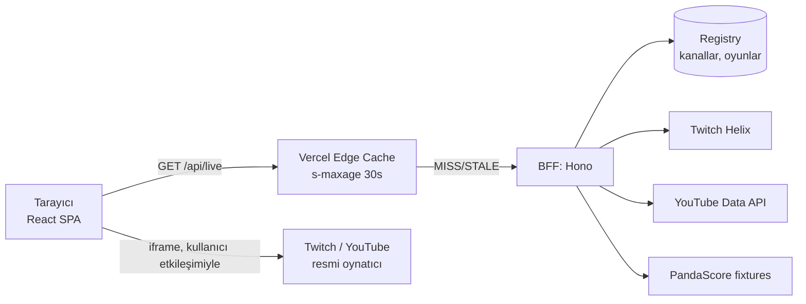

# RageTV — architect.md

> **Bu belge, RageTV için ürün ve mimari kararların tek doğruluk kaynağıdır.**
> `agent-rules.md` ile çelişirse `agent-rules.md` önceliklidir.
> **DOĞRULA** etiketi: resmi kaynaktan Faz 0'da doğrulanmadan koda geçirilmeyecek bilgi.
> Belirsiz bir noktada varsayım yapma; "Açık Sorular" bölümüne ekle ve Sercan'a sor.
> İlk iş: Bölüm 17 (Faz Planı) M0 ve M1. Kodlamaya başlamadan önce plan çıkar, onay iste.

---

## 1. PROJE TANIMI VE HEDEFİ

**RageTV**, minimalist ve hızlı bir espor canlı yayın **aracı sitesidir** (aggregator). Kullanıcı siteye girer, solda sidebar'dan oyunu seçer (CS2, Valorant, PUBG, LoL, Dota 2), sağdaki alanda o oyunun şu an canlı olan resmi espor yayını **kaynak platformun resmi gömülü oynatıcısıyla** açılır. Canlı yayın yoksa ekran boş kalmaz: o oyunun yakın zamanda yayınlanmış son maçı/turnuva maçı duraklatılmış (poster) halde durur, tıklanınca oynar.

**Ürün ilkeleri (pazarlık konusu değil):**
1. **Aracı site, yalnızca embed.** Video barındırmaz, kaydetmez, proxy'lemez, restream etmez. Oynatıcı kaynak platformunun resmi, değiştirilmemiş oynatıcısıdır; platformun logosu/kontrolleri ona aittir.
2. **Minimalist ve hızlı.** Sidebar → tek tık → izle. Gereksiz ekran, modal, banner yok.
3. **Kayıt/giriş yok.** Tercihler (tema, dil, son oyun) yalnızca cihazda (localStorage) tutulur.
4. **Ticari değil.** Reklam, ödeme, bahis/oran (odds) içeriği yok. (Barındırma planı koşullarıyla da uyumlu, bkz. Bölüm 9.)
5. **Dürüst veri.** Gösterilen her durum/sayı gerçek kaynaktan gelir; bilinmeyen sıfır değil `N/A`'dır (Bölüm 15).
6. **Geleceğe hazır, aşırı mühendislik değil.** Modül sınırları ve adapter'lar şimdi kurulur; özellikler fazlara bölünür.

**Kapsam dışı (non-goals):** sohbet (chat) embed'i, restream, herhangi bir siteyi scrape etmek, kullanıcı hesapları, reklam, bahis/oran verisi, DVR/kayıt.

---

## 2. KRİTİK TASARIM KARARLARI VE GEREKÇELERİ

| # | Karar | Gerekçe |
|---|---|---|
| D1 | **Yalnızca resmi embed oynatıcıları** (Twitch, YouTube; Kick Faz 2) | Video akışı kaynak platformdan gelir. Platform şartlarına uymak zorunludur (Bölüm 8). Bu, hukuki koruma garantisi değildir; disclaimer da koruma sağlamaz, yalnızca şeffaflıktır. |
| D2 | **HLTV ve benzeri sitelerden scraping YOK** | Resmi API yok, şartlar ihlal edilir, Cloudflare engeli ve kırılganlık. HLTV'ye yalnızca dışa bağlantı verilebilir. İzinsiz/gayriresmî endpoint (örn. Kick `kick.com/api/v2`) kullanılmaz. |
| D3 | **Canlı durum için ince bir sunucu katmanı (BFF) şarttır** | Twitch/YouTube/PandaScore anahtarları tarayıcıya konamaz. Ayrıca "canlı mı?" bilgisi dakikalar içinde değişir; DevSec Status'taki "cron + statik JSON" modeli burada **uygun değildir**. |
| D4 | **Cron ile polling YOK; CDN önbellekli, isteğe bağlı (on-demand) endpoint'ler** | Vercel Hobby'de cron günde en fazla bir kez çalışabilir ve zamanlaması saat içinde kayabilir (DOĞRULA: güncel limitler). Çözüm: `/api/*` yanıtları `s-maxage` + `stale-while-revalidate` ile önbelleğe alınır. |
| D5 | **Tek paket, katı katman sınırları** (`shared/`, `server/`, `src/`) | Şimdilik monorepo ceremony'si gereksiz. Sınırlar lint ile zorlanır; ileride `apps/web` + `apps/api`'ye bölmek mekanik olur. Bölme tetikleyicileri: kalıcı veritabanı, hesaplar, WebSocket, ikiden fazla periyodik iş. |
| D6 | **Atomic Design yerine feature-based modüler yapı** | Atomic Design görsel granülerliğe göre dizer; değişimin ekseni ise özelliklerdir (player, live, fixtures). UI primitifleri `components/ui` altında kalır. |
| D7 | **Vite SPA (Next.js değil)** | Uygulama büyük ölçüde istemci tarafı (iframe, sidebar). Sunucu ihtiyacı BFF ile karşılanıyor. SEO/OG kartları öncelik olursa (maç bazlı paylaşım) Next.js yeniden değerlendirilir (ADR ile). |
| D8 | **Sağlayıcı (provider) adapter deseni** | Twitch, YouTube, PandaScore, Kick değişebilir/kapanabilir. Domain tipleri sağlayıcıdan bağımsızdır; sağlayıcı değişimi tek klasörü etkiler. |
| D9 | **Kill switch**: kanal/platform tek commit ile kapatılabilir | İçerik sahibi talebi veya platform politika değişikliğinde hızlı kaldırma. |

---

## 3. KAPSAM VE FAZLAR (ÖZET)

- **v1 (M1–M3, M6):** 5 oyunluk sidebar, canlı durum göstergesi, resmi embed oynatıcı, VOD/poster yedeği, tema, i18n (EN/TR/DE), responsive, footer disclaimer, güvenlik başlıkları, CI.
- **v1.1 (M4):** Fikstür: yaklaşan maç listesi, geri sayım, sonuçlar.
- **v1.2 (M5):** Puan durumu/standings (veri kaynağı doğrulanırsa).
- **Faz 2 (ayrı karar):** Kick adaptörü, aynı oyunda birden çok yayın seçici (dil/co-stream), dil tercihine göre yayın, bildirimler. (Hesaplar ve kalıcı backend için ayrı ADR gerekir.)

---

## 4. EKRAN VE UX SPESİFİKASYONU

**Genel yerleşim (laptop ve üzeri, ≥1024px; ayrıntı 4.1)**
- Sol sidebar (dar, daraltılabilir): en üstte logo, sonra oyunlar sırasıyla **CS2 → Valorant → PUBG → LoL → Dota 2**, altta dil ve tema kontrolleri.
- Sağ sahne (`PlayerStage`): 16:9 oynatıcı. Altında ince bilgi satırı: yayın başlığı, platform rozeti, izleyici sayısı (varsa), "Open on Twitch ↗" bağlantısı.
- Footer: sayfa altında **ortalanmış** disclaimer (Bölüm 13).

**Mobil ve tablet (<1024px; ayrıntı 4.1)**
- Sidebar yerine üstte yatay kaydırılan oyun sekmeleri; oynatıcı tam genişlikte. (Alt gezinme çubuğu alternatifi Açık Sorular'da.)
- Mobilde autoplay güvenilir değildir; kullanıcı Play'e basar. Dar ekranlarda (<400px) Twitch minimum boyut koşulu sorun olabilir (Bölüm 8).

**Durumlar (her oyun için)**
| Durum | Gösterim |
|---|---|
| `loading` | Skeleton (LCP elemanı oynatıcı değil, skeleton/poster olmalı) |
| `live` | Resmi embed oynatıcı, "LIVE" rozeti (renk tek başına taşıyıcı değil: metin + nokta) |
| `vod` | Son yayın posteri (facade): "Son yayın · tarih" etiketi, Play ile iframe yüklenir |
| `blocked` | Embed yüklenemedi/engellendi: kart + "Watch on Twitch/YouTube" dış bağlantısı |
| `empty` | Ne canlı ne VOD: sakin mesaj + resmi kanala bağlantı |
| `stale` | API ulaşılamıyor: son bilinen veri + "veri eski olabilir" notu ve `fetchedAt` |

**Yönlendirme:** `/:gameSlug` (`cs2`, `valorant`, `pubg`, `lol`, `dota2`). `/` → son seçilen oyun (localStorage) → yoksa ilk canlı oyun (sidebar sırasına göre) → yoksa `cs2`. Bilinmeyen slug → 404 sayfası. Opsiyonel `?stream=<id>`.

**Sidebar canlı göstergesi:** `/api/live` tek istekle tüm oyunların durumunu döner; her oyunun yanında LIVE göstergesi.

**Erişilebilirlik:** `nav` landmark, `aria-current="page"`, görünür odak halkası, `prefers-reduced-motion`, iframe `title`, WCAG AA kontrast, klavye ile tam gezinme.

**Görsel tasarım:** Referanslar Sercan tarafından eklenecek. Agent, `src/styles/tokens.css` içinde renk/yarıçap/boşluk/tipografi token'larını tanımlar; bileşenler token kullanır. Varsayılan **dark**. Vurgu rengi Açık Sorular'da. Fontlar self-host (WOFF2, subset, `font-display: swap`); Google Fonts kullanılmaz.

**Başlık (`<title>`) ve açıklama (öneri, onay bekler):**
- EN: `RageTV – Pick a game. Watch live esports.`
- TR: `RageTV – Bir oyun seç, canlı espor izle.`
- DE: `RageTV – Spiel wählen. Live-Esports schauen.` *(AI destekli çeviri, gözden geçirilecek)*
- Footer kısa açıklama (EN): `A minimal hub for live esports: CS2, Valorant, PUBG, LoL and Dota 2.`

---

## 5. ÖZELLİK HAVUZU (ŞABLONDAN SEÇİM)

- [x] Özel isim (RageTV) ve logo
- [x] Özel tema vurgu rengi (Açık Sorular)
- [x] Modern UX/UI (referanslar eklenecek)
- [x] Web & mobil uyumluluk (full-responsive)
- [x] Light / Dark mode (varsayılan: dark)
- [x] Dil seçeneği: EN / TR / DE (tarayıcı dili algılama; yedek dil: EN, onay bekler)
- [ ] ~~Scroll-Up butonu~~ → v1'de gerekmez (tek ekranlık yerleşim). Fikstür listesi uzarsa M4'te yeniden değerlendirilir.
- [ ] ~~Login & Sign Up~~ → bilinçli olarak yok. Gelecek için yalnızca `preferences` modülünde depolama adapter'ı bulunur (ADR-003).
- [ ] ~~Sirv/Image CDN, tüm görseller .webp~~ → Statik varlık çok az: SVG/WebP `public/` altında self-host. Oynatıcı posterleri sağlayıcı CDN'inden gelir.
- [x] Tech: PNPM, Vite, HTML, CSS, JavaScript, TypeScript, React.js, Node.js (sunucusuz fonksiyon çalışma ortamı)
- [ ] ~~Docker, Vue.js, Angular, Next.js, Python, PHP, Java, Go, SQL, AI~~ → gerekmiyor
- [x] Unit / Integration testleri

## 6. TEKNİK STANDARTLAR (ŞABLONDAN SEÇİM)

- [ ] ~~Atomic Design~~ → yerine **feature-based modüler yapı** (D6)
- [x] **Component-Based Architecture**
- [x] **Conventional Commits** (`feat(player): ...`)
- [x] **Frontend XSS koruması**: dış kaynaktan gelen her metin düz metin olarak render edilir; `dangerouslySetInnerHTML` yasak (lint kuralı); URL'ler allowlist ile doğrulanır
- [x] **Backend koruması (Helmet yerine eşdeğeri)**: Helmet bir Express ara katmanıdır; burada güvenlik başlıkları `vercel.json` ve Hono middleware ile verilir. Rate limiting: CDN önbelleği + sağlayıcı çağrı bütçesi + devre kesici (Bölüm 7.5)
- [x] **Unit test** (Vitest)
- [x] **Caching** (çekirdek tasarım parçası, Bölüm 7.4)
- [x] **Custom CSP, Referrer Policy, Permissions-Policy** (Bölüm 10)

**Seçilen yığın (sürümleri agent güncel kararlı sürüme sabitler ve ADR'ye yazar):**
- Node.js LTS, **PNPM**, **Vite**, **TypeScript (strict, `noUncheckedIndexedAccess`)**
- **React**, **React Router**, **Tailwind CSS**, Radix UI primitifleri (gerektiğinde, shadcn tarzı kopyala-kullan), `lucide-react`
- **TanStack Query** (polling, dedupe, stale-while-revalidate), **zod** (sınır doğrulaması, istemci ve sunucu paylaşımlı)
- **i18next + react-i18next** (dil dosyaları lazy-load)
- BFF: **Hono** + `hono/vercel` adaptörü, Vercel Functions üzerinde. Hono taşınabilirlik içindir (Cloudflare/Node'a geçiş kolay). M1'de çalıştığı doğrulanır; çalışmazsa dosya-başı fonksiyonlara düşülür, katman sınırları değişmez.
- Test: **Vitest**, Testing Library, **MSW**, vitest-axe. E2E (Playwright) M6'da, yalnızca smoke.
- Kalite: **ESLint** (typescript-eslint, react-hooks, jsx-a11y, import sınırları), Prettier, commitlint. *(DevSec Status'ta `lint` yalnızca tsc idi; burada gerçek ESLint var.)*

---

## 7. MİMARİ

### 7.1 Katmanlar ve bağımlılık kuralları

```
shared/   → hiçbir katmana bağımlı değil (tipler, zod şemaları, registry, URL builder'lar)
server/   → shared/
src/      → shared/ (yalnızca tip/şema/registry); server/ import edilemez
```

Kural lint ile zorlanır (`import/no-restricted-paths` veya `eslint-plugin-boundaries`). İhlal = CI hatası.

### 7.2 Akış



### 7.3 Provider adapter deseni

```ts
// shared/schemas: Stream, VodItem, Match (zod). Sağlayıcıdan bağımsız domain tipleri.
type Result<T> =
  | { ok: true; data: T; fetchedAt: string }
  | { ok: false; error: ProviderError; stale?: T };

interface LiveProvider   { id: ProviderId; getLive(channels: ChannelRef[]): Promise<Result<Stream[]>> }
interface VodProvider    { id: ProviderId; getLatest(source: VodSourceRef): Promise<Result<VodItem | null>> }
interface FixturesProvider { id: ProviderId; getUpcoming(g: GameId): Promise<Result<Match[]>>; getResults(g: GameId): Promise<Result<Match[]>> }
```

- Sağlayıcı yanıtları **zod ile doğrulanır**, domain tipine **mapper** ile çevrilir. Doğrulanamayan yanıt = `ok:false`.
- Hata sınırı boyunca exception fırlatılmaz; `Result` döner.
- **Registry (kod değil veri):** `shared/registry/games.ts` — her oyun için `id`, `slug`, `i18nKey`, `order`, `providerMappings` (örn. PandaScore slug'ı; **CS2 için PandaScore yolu `/csgo/` önekidir**, DOĞRULA), `channels: ChannelRef[]` (`platform`, `login/id`, `label`, `language`, `official`, `priority`), `vodSources`. Kanal adlarını agent **uydurmaz**; M0'da resmi kaynaklardan doğrular.
- **Yayın seçimi** saf fonksiyondur: `selectPrimaryStream(streams, prefs)` — öncelik (`priority`), resmî olma, dil tercihi, izleyici sayısı sırasıyla. Birim testlidir.
- **İki canlı-tespit stratejisi, adapter arkasında:**
  - **A (taban):** Registry'deki resmi kanallar → Twitch Helix `streams` (tek istekte çoklu `user_login`) → hangileri canlı.
  - **B (doğrulanırsa):** PandaScore `running` maçları → maç yayın bilgileri (`streams_list`, DOĞRULA: ücretsiz planda geliyor mu, kullanım şartları).
  A zorunlu, B opsiyoneldir.
- **VOD:** Öncelik, kanal "uploads" akışı değil, **belirli playlist** (tam maç/ana yayın playlist'i); aksi halde son yüklenen video fragman/özet olabilir. Twitch arşivleri (VOD) saklama süresi sınırlıdır; yalnızca yedek.

### 7.4 Önbellek stratejisi

| Endpoint | `s-maxage` | `stale-while-revalidate` | Not |
|---|---|---|---|
| `GET /api/live` | 30 sn | 60 sn | Tüm oyunlar tek yanıt |
| `GET /api/vod?game=` | 10 dk | 1 saat | |
| `GET /api/fixtures?game=` | 2 dk | 10 dk | M4 |
| `GET /api/health` | 0 | — | Sürüm, sağlayıcı durumu (gizli bilgi yok) |

- Vercel CDN önbelleği bölgeseldir; sağlayıcıya giden istek ≈ bölge sayısı × (60 / TTL). Sağlayıcı bütçeleri buna göre doğrulanır.
- Twitch app token'ı bellekte `expires_in`'e göre önbelleğe alınır; her istekte yenilenmez.
- İstemci: TanStack Query `refetchInterval: 30_000`, **sekme görünür değilken durur**, `retry` üstel geri çekilmeli.
- Sağlayıcı verisinin saklanma/önbellek koşulları sağlayıcı şartlarına tabidir (Faz 0'da DOĞRULA).

### 7.5 Dayanıklılık

- **Devre kesici:** N ardışık hatada T saniye sağlayıcıyı çağırma; önbellekteki son iyi veriyi `stale: true` ile dön.
- **Zaman aşımı:** her sağlayıcı çağrısı için kısa timeout (varsayılan 5 sn; Hobby fonksiyon süresi sınırı göz önünde).
- **Hata asla sıfıra çevrilmez.** Bilinmiyorsa `null`/`N/A`, `empty` veya `stale` durumu.
- **Kill switch:** `shared/registry/killswitch.ts` (kanal/platform kapatma). Değişiklik tek commit + deploy. (İleride Edge Config değerlendirilebilir.)

### 7.6 API kontratı (özet)

```jsonc
// GET /api/live
{
  "fetchedAt": "2026-10-20T12:00:00.000Z",
  "stale": false,
  "games": {
    "cs2": { "live": [ { "id": "twitch:esl_csgo", "platform": "twitch", "channel": "esl_csgo",
                          "title": "…", "language": "en", "official": true, "viewers": 12345 } ] },
    "valorant": { "live": [] }
  }
}
```
Tüm yanıtlar zod şemasıyla doğrulanır; şemalar `shared/schemas`'tadır; istemci aynı şemayı kullanır.

---

## 8. EMBED UYUM KURALLARI (DOĞRULANMIŞ + DOĞRULA)

**Twitch (resmi dokümandan doğrulandı):**
- Embed kullanan alan adları **SSL** kullanmalı.
- `parent` parametresi **zorunludur** (iframe `src` içinde); eksikse oynatma hatası görünür. Değer çalışma anında `window.location.hostname`'den alınır (yerel, preview ve prod hepsi için).
- Yalnızca **Twitch onaylı oynatıcı öğeleri** kullanılır; oynatıcı **başka sayfa öğeleriyle örtülmez**. Uyumsuz alan adlarının embed hakkı iptal edilebilir.
- Önerilen/gerekli minimum boyut **400×300**; **autoplay** için boyut ve görünürlük koşulları gerekir (aksi halde autoplay engellenir).
- URL kalıbı: `https://player.twitch.tv/?channel=<login>&parent=<host>&muted=true` · VOD: `?video=v<id>&parent=<host>&autoplay=false`.
- Dar telefonlarda (<400px) boyut koşulu gerilimi: Faz 0'da gerçek cihazda test edilir; çözüm yoksa dar görünümde "Watch on Twitch" dış bağlantısına düşülür.

**YouTube:** `https://www.youtube-nocookie.com/embed/<id>`. Yükleyici embed'i kapatmış olabilir → `blocked` durumu. YouTube API Services şartlarının zorunlu gösterim/bağlantı ve veri saklama kuralları DOĞRULA.

**Kick (Faz 2):** Resmî genel API OAuth ile çalışır (uygulama erişim token'ı ile herkese açık veri); embed oynatıcı kullanım şartları DOĞRULA. Kick'in gayriresmî `api/v2` uçları **kullanılmaz**.

**Genel iframe kuralları:** `allow="autoplay; fullscreen; picture-in-picture"`, `title`, `referrerpolicy="strict-origin-when-cross-origin"`, `allowfullscreen`. `sandbox` yalnızca her sağlayıcıyla test edilirse eklenir. İframe **yalnızca kullanıcı etkileşimiyle** (oyun seçimi/Play) yüklenir (facade). Oynatıcı üzerine hiçbir şey bindirilmez, kırpılmaz, yeniden boyanmaz.

**Her embed için `blocked` yedeği** zorunludur ve "kaynakta izle" dış bağlantısı her zaman görünür.

---

## 9. SAĞLAYICILAR (FAZ 0 ÇIKTISI: `docs/providers.md`)

| Sağlayıcı | Amaç | Kimlik | Not (DOĞRULA) |
|---|---|---|---|
| Twitch Helix + Embed | Canlı durum, VOD, oynatıcı | App access token (client credentials, sunucuda) | Geliştirici sözleşmesi, veri önbellek/saklama, istek limitleri |
| YouTube Data API + Embed | VOD/playlist, oynatıcı | API anahtarı (sunucuda) | Günlük kota; `playlistItems` ucuz, `search` pahalı → arama kullanma |
| PandaScore (REST) | Fikstür, sonuç, çalışan maçlar | Token (sunucuda) | **Ücretsiz "Fixtures" planı mevcut**; CS2 uçları `/csgo/` öneklidir; Valorant için canlı veri planı yoktur; ücretsiz limit ~1000 istek/saat (üçüncü taraf kaynak, DOĞRULA); PUBG kapsamı DOĞRULA; ticari olmayan kullanım/atıf şartları DOĞRULA |
| Kick (Faz 2) | Canlı durum, oynatıcı | OAuth 2.1 (app token) | Embed şartları DOĞRULA |
| HLTV | — | — | **Kullanılmaz** (scraping yok). |
| Liquipedia | (opsiyonel) | — | Şartlar/atıf/hız sınırları sıkı; Faz 0'da değerlendirilir, varsayılan olarak kapalı |

**Barındırma (Vercel):** Hobby plan **ticari olmayan kişisel kullanımla** sınırlıdır; cron günde bir; fonksiyon süresi varsayılan 10 sn (DOĞRULA: güncel değerler). Reklam/ödeme/gelir eklenirse Pro'ya geçiş gerekir (ADR).

---

## 10. GÜVENLİK

**CSP taslağı** (M1'de gerçek host'larla netleştirilir, her genişletme gerekçelendirilir):

```
default-src 'self';
script-src 'self';
style-src 'self';
font-src 'self';
img-src 'self' https://static-cdn.jtvnw.net https://i.ytimg.com https://cdn.pandascore.co;   # DOĞRULA: gerçek host'lar
connect-src 'self';
frame-src https://player.twitch.tv https://www.youtube-nocookie.com;                          # Kick: Faz 2
object-src 'none'; base-uri 'self'; form-action 'self'; frame-ancestors 'none'; upgrade-insecure-requests
```

- `unsafe-inline` ve `data:` **varsayılan olarak yok**; yalnızca kanıtlanmış ihtiyaçta, ADR ile.
- Diğer başlıklar: `Strict-Transport-Security`, `X-Content-Type-Options: nosniff`, `Referrer-Policy: strict-origin-when-cross-origin`, `Permissions-Policy` (kamera/mikrofon/konum kapalı; **autoplay ve fullscreen'i engelleme**), `Cross-Origin-Opener-Policy: same-origin`. COEP **ayarlanmaz** (embed'leri bozar).
- **Gizli bilgiler:** yalnızca sunucu ortam değişkenleri (`TWITCH_CLIENT_ID`, `TWITCH_CLIENT_SECRET`, `YOUTUBE_API_KEY`, `PANDASCORE_TOKEN`). `VITE_` önekiyle **asla**. `.env.example` bulunur. CI'da `dist/` içinde secret kalıpları taranır.
- **URL allowlist testi:** registry'deki tüm URL/host'lar, embed host'ları ve görsel host'ları test ile doğrulanır (`//evil.com`, `/\evil.com`, `javascript:` negatif testleri dahil; kural tek modülden: `shared/urls.ts`).
- Dış kaynaklı metinler (yayın başlığı vb.) düz metin render edilir.
- **Tedarik zinciri:** sabit sürümler, lockfile, `--frozen-lockfile`, GitHub Actions SHA ile sabitlenir, Dependabot, pnpm `onlyBuiltDependencies` allowlist'i, minimal bağımlılık politikası.
- `SECURITY.md` + Private Vulnerability Reporting; kişisel e-posta **yayınlanmaz**.
- Güvenlik başlıkları Mozilla Observatory ve CSP Evaluator ile doğrulanır (hedef: A+, CSP'de `script-src` temiz).

---

## 11. PERFORMANS ve ERİŞİLEBİLİRLİK BÜTÇESİ

- Mobil Lighthouse: **LCP ≤ 2.0 sn, TBT ≤ 200 ms, CLS ≤ 0.05**, Performans ≥ 90 (3 çalışmanın medyanı). Başlangıç JS ≤ ~150 KB gzip (iframe'ler hariç).
- Route bazlı code splitting; dil dosyaları lazy; oynatıcı/üçüncü taraf kod yalnızca etkileşimle.
- Self-host fontlar; görsellerde boyut öznitelikleri; sağlayıcı poster görselleri `loading="lazy"`.
- Erişilebilirlik: vitest-axe testleri, klavye gezinmesi, odak yönetimi (oyun değişince oynatıcı alanına anons).

---

## 12. i18n

- TR/EN/DE; tarayıcı dili algılama; **yedek dil EN** (onay bekler). Dil dosyaları lazy.
- Sayı/tarih/saat/göreli zaman yalnızca `Intl.*` ile (DevSec'teki "251.689" hatasının tekrarı yok). Fikstür saatleri UTC'den kullanıcının saat dilimine çevrilir.
- Birleştirilmiş çeviri cümleleri yok; anahtarlar özellik bazlı; testte tüm dillerde anahtar eşitliği.
- Çeviriler AI destekli olarak işaretlenir; ana dil konuşanlardan katkı davet edilir.

## 13. DISCLAIMER (footer, altta ortalanmış)

**EN:** RageTV is an independent, non-commercial esports discovery site. It does not host, record or rebroadcast any video. Live streams and videos are shown through the official embedded players of their original platforms (such as Twitch and YouTube) and remain the property of their respective owners. All trademarks, logos and game titles belong to their respective owners; RageTV is not affiliated with, endorsed by or sponsored by them. Content owners can request removal via `{{CONTACT_URL}}`.

**TR:** RageTV, bağımsız ve ticari olmayan bir espor keşif sitesidir. Hiçbir video içeriğini barındırmaz, kaydetmez veya yeniden yayınlamaz. Canlı yayınlar ve videolar, özgün platformların (Twitch, YouTube vb.) resmi gömülü oynatıcıları aracılığıyla gösterilir ve ilgili sahiplerine aittir. Tüm ticari markalar, logolar ve oyun adları sahiplerine aittir; RageTV bunlarla bağlantılı değildir, onlar tarafından onaylanmamış veya desteklenmemiştir. İçerik sahipleri kaldırma taleplerini `{{CONTACT_URL}}` üzerinden iletebilir.

**DE:** AI destekli çeviri olarak üretilir, gözden geçirme notuyla işaretlenir.

- `{{CONTACT_URL}}`: varsayılan olarak repo Issues sayfası (kişisel e-posta kullanılmaz).
- Oyun/marka logoları v1'de kullanılmaz: metin etiketi + nötr ikon. Resmî marka kılavuzları incelenmeden logo eklenmez.
- Bu metin hukuki danışmanlık değildir ve telif sorumluluğunu ortadan kaldırmaz; amaç şeffaflıktır.

---

## 14. KLASÖR YAPISI

```
ragetv/
├── agent-rules.md
├── architect.md
├── .github/
│   ├── workflows/ci.yml                 # pull_request; permissions: contents: read
│   ├── ISSUE_TEMPLATE/
│   ├── PULL_REQUEST_TEMPLATE.md
│   └── dependabot.yml
├── api/
│   └── [[...route]].ts                  # Vercel giriş noktası → server/app
├── server/                              # BFF (React import edemez)
│   ├── app.ts                           # Hono app, middleware
│   ├── routes/                          # live.ts, vod.ts, fixtures.ts, health.ts
│   ├── providers/
│   │   ├── twitch/                      # client, live, vod, mapper (+ testler)
│   │   ├── youtube/
│   │   ├── pandascore/
│   │   └── kick/                        # Faz 2
│   ├── domain/                          # selectPrimaryStream.ts vb. saf mantık
│   └── lib/                             # cache, http, circuitBreaker, env
├── shared/                              # izomorfik
│   ├── schemas/                         # stream, vod, match, game (zod)
│   ├── registry/                        # games.ts, channels, killswitch.ts
│   └── urls.ts                          # embed URL builder + allowlist doğrulama
├── src/
│   ├── app/                             # App, router, providers
│   ├── features/
│   │   ├── games/                       # GameSidebar, GameNavItem
│   │   ├── player/                      # EmbedPlayer, PlayerStage, VodFacade, state bileşenleri
│   │   ├── live/                        # useLiveStatus, api client
│   │   ├── fixtures/                    # M4
│   │   ├── standings/                   # M5
│   │   └── preferences/                 # storage adapter: tema, dil, son oyun
│   ├── components/ui/                   # Button, Badge, Skeleton, Tooltip …
│   ├── layouts/                         # AppShell, Sidebar, MobileNav, Footer
│   ├── lib/                             # formatters (Intl), cn
│   ├── i18n/locales/{en,tr,de}.json
│   ├── styles/                          # tokens.css, index.css
│   └── main.tsx
├── public/                              # favicon, og görseli, robots.txt, fontlar
├── docs/
│   ├── providers.md                     # M0 çıktısı
│   └── adr/                             # 001-vite-spa, 002-bff-hono, 003-preferences-adapter …
├── tests/                               # e2e (M6)
├── vercel.json  vite.config.ts  tsconfig*.json  eslint.config.js  package.json
└── LICENSE  README.md  CONTRIBUTING.md  SECURITY.md  .env.example
```

**Hazır gelen dosyalar:** `vite.config.ts` ve `vercel.json` DevSec Status'tan kopyalandı. **Agent bunları baştan gözden geçirir:** DevSec'e özgü CSP/başlıkları kaldırır, Bölüm 10 CSP'sini uygular, SPA rewrite'ında `/api/*`'ı hariç tutar, çıktı klasörünü ve sunucusuz fonksiyon ayarlarını doğrular.

---

## 15. VERİ DÜRÜSTLÜĞÜ KURALLARI (DevSec Status'tan çıkan dersler — bağlayıcı)

1. **Hiçbir UI değeri/durumu sabit kodlanmaz.** Mock veri yalnızca testlerde ve fixture dosyalarındadır; üretim yolunda yer tutucu/uydurma veri yok.
2. **Bilinmeyen ≠ 0.** Eksik veri `null`/`N/A` gösterilir.
3. **Her veri bloğu kaynak ve `fetchedAt` taşır.** Kullanıcı arayüzünde gerektiğinde görünür.
4. **"Canlı/real-time" ifadesi** yalnızca gerçekten ≤60 sn tazelenen veride kullanılır. README/UI iddiaları test veya komutla doğrulanabilir olmalı.
5. **Agent raporları kanıt içerir** (komut çıktısı). Token/secret değeri yazdıran komut **çalıştırılmaz** (`gh auth token`, `printenv`, `echo $SECRET` vb.).
6. **Locale-aware biçimlendirme** baştan (`Intl`). Sabit string birleştirme yok.
7. **Üçüncü taraf host'lar** allowlist + test ile sınırlıdır; yeni host = gerekçe + test.
8. **Küratörlü veri** (registry) için doğrulama: kanal gerçekten resmi mi, kaynak linki `docs/providers.md`'de.
9. `main`'e doğrudan push yok; `agent-rules.md` akışı geçerlidir.

---

## 16. TEST STRATEJİSİ

- **Birim:** `selectPrimaryStream`, URL builder'lar/allowlist, mapper'lar (kayıtlı ve temizlenmiş fixture yanıtlarıyla), formatter'lar.
- **Sözleşme (contract):** sağlayıcı yanıt şemaları fixture ile; şema değişirse test kırılır.
- **Entegrasyon:** MSW ile istemci durumları (`loading/live/vod/blocked/empty/stale`).
- **Veri:** registry bütünlüğü (benzersiz id, zorunlu alanlar, host allowlist, kill switch).
- **Erişilebilirlik:** vitest-axe, klavye gezinmesi.
- **i18n:** tüm dillerde anahtar eşitliği.
- **CI (`pull_request`, `contents: read`):** `pnpm install --frozen-lockfile` → typecheck → lint → test → build → `dist` secret taraması. `pull_request_target` **kullanılmaz**.

---

## 17. FAZ PLANI (HER FAZIN KABUL KRİTERİ)

| Faz | İçerik | Kabul kriteri |
|---|---|---|
| **M0** | Sağlayıcı/ŞART araştırması (kod yok): `docs/providers.md`, ADR taslakları, Twitch/YouTube/PandaScore/Kick şartları, 5 oyun için resmi kanal ve playlist listesi, Vercel limitlerinin güncel doğrulaması | Her DOĞRULA maddesi kaynak bağlantısıyla kapatıldı; açık risk listesi çıkarıldı |
| **M1** | Temel: iskelet, araçlar, CI, tokenlar, AppShell + sidebar (statik), i18n iskeleti, rotalar, güvenlik başlıkları, `/api/health`, preview deploy | CI yeşil; Observatory A+; boş uygulama Lighthouse mobil ≥90; katman sınırı lint'i çalışıyor |
| **M2** | Canlı: Twitch adaptörü + registry, `/api/live`, `useLiveStatus`, EmbedPlayer + durumlar, sidebar LIVE göstergesi | Gerçek canlı bir yayın uçtan uca açılıyor (kanıt: ekran görüntüsü + log); devre kesici/stale testleri geçiyor |
| **M3** | VOD/poster yedeği (YouTube/Twitch), facade, `blocked/empty` durumları | Hiçbir oyunda "boş ekran" yok; embed kapalı video için yedek çalışıyor |
| **M4** | Fikstür (PandaScore): yaklaşan, geri sayım, sonuçlar | Veri kaynağı ve zaman dilimi doğru; `N/A` kuralları uygulanıyor |
| **M5** | Standings (kaynak doğrulanırsa) | Kaynak yoksa faz kapatılır/ertelenir (ADR) |
| **M6** | Sertleştirme: performans/a11y denetimi, e2e smoke, README, SECURITY/CONTRIBUTING, yayın kontrol listesi | Bölüm 11 bütçesi sağlandı; tüm README iddiaları doğrulandı |

**Global Definition of Done:** typecheck + lint + test + build yeşil; yer tutucu veri yok; dokümantasyon güncel; yeni üçüncü taraf host'u/bağımlılığı gerekçeli.

---

## 18. BAŞLANGIÇ GÖREVİ (AGENT İÇİN İLK PROMPT)

```
Bu belgeyi (architect.md) ve agent-rules.md'yi oku. Kod yazmadan önce:
1. M0'ı yap: docs/providers.md ve gerekli ADR taslaklarını üret. Her DOĞRULA
   maddesi için resmi kaynak bağlantısı ver; doğrulayamadığını açıkça belirt.
2. vite.config.ts ve vercel.json'ı gözden geçir (Bölüm 14 notu) ve gerekli
   değişiklikleri listele (uygulamadan önce onay iste).
3. Bölüm 19'daki Açık Sorular için, varsayımlarını belirterek net sorular sor.
4. M1 için adım adım bir plan çıkar ve onayımı bekle.
Kurallar: scraping yok; gayriresmî endpoint yok; secret yazdıran komut yok;
uydurma kanal/URL yok; kanıt (komut çıktısı) olmadan "tamamlandı" deme.
```

---

## 19. AÇIK SORULAR / VARSAYIMLAR (Sercan'ın onayı gerekir)

1. **İsim/alan adı:** "RageTV" — GitHub repo: `https://github.com/sercanvr/ragetv.git`.
2. **Varsayılan dil:** tarayıcı dili algılama + yedek **EN** (varsayılan).
3. **Vurgu rengi:** `#FC3564` (Rage Crimson/Coral) olarak onaylandı. Referans 5 UI incelendi.
4. **Mobil gezinme:** Üst yapışkan oyun filtre sekmeleri (sticky game pills) + ergonomik alt gezinme çubuğu (bottom bar) hibrit yaklaşımı benimsendi.
5. **Aynı oyunda birden fazla canlı yayın:** v1'de tek ana yayın; birden çok varsa küçük seçici (varsayım).
6. **Kick:** v1'de yok (varsayım); şartlar doğrulanınca Faz 2.
7. **PUBG:** v1'de resmi kanal ve VOD odaklı.
8. **Lisans:** MIT Lisansı oluşturuldu ve onaylandı.
9. **Analitik:** yok.
10. **İçerik kaldırma iletişimi:** repo Issues (`https://github.com/sercanvr/ragetv/issues`).
11. **Barındırma:** Vercel Hobby (ticari olmayan, sıfır maliyetli).

---

## 20. NOTLAR (AGENT İÇİN)

- Bu proje DevSec Status'tan **mimari olarak farklıdır** (dinamik, sunucu katmanlı). DevSec'in "cron + statik JSON" kalıbını kopyalama.
- Platform koşulları değişebilir: embed/şart doğrulaması M0'da ve her sağlayıcı entegrasyonundan önce tekrarlanır.
- Embed, hukuki güvence değildir; kill switch, kaldırma talebi süreci ve şeffaf disclaimer bu yüzden zorunludur.
- Küçük adımlar, her adımda test ve kanıt. Kapsamı sessizce genişletme; yeni fikirler ADR veya Açık Sorular'a yazılır.
